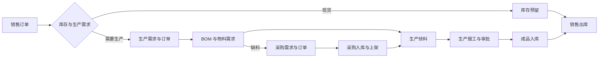
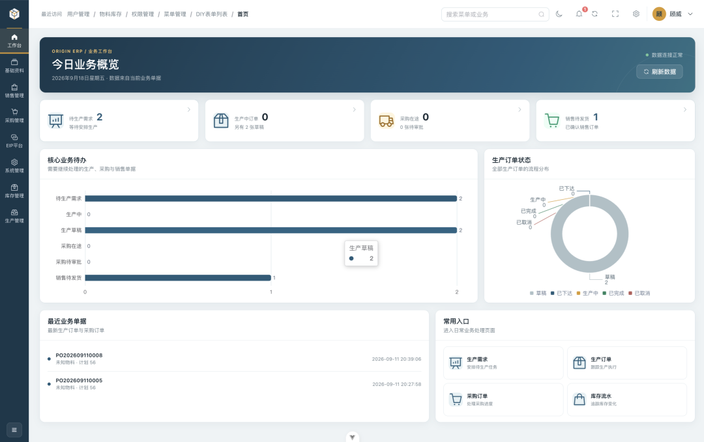
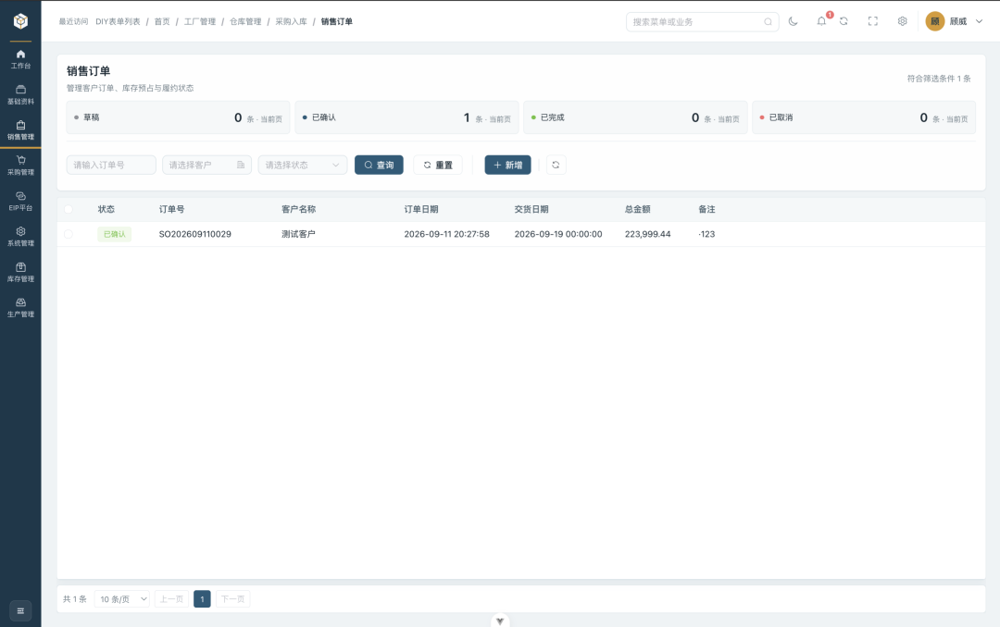
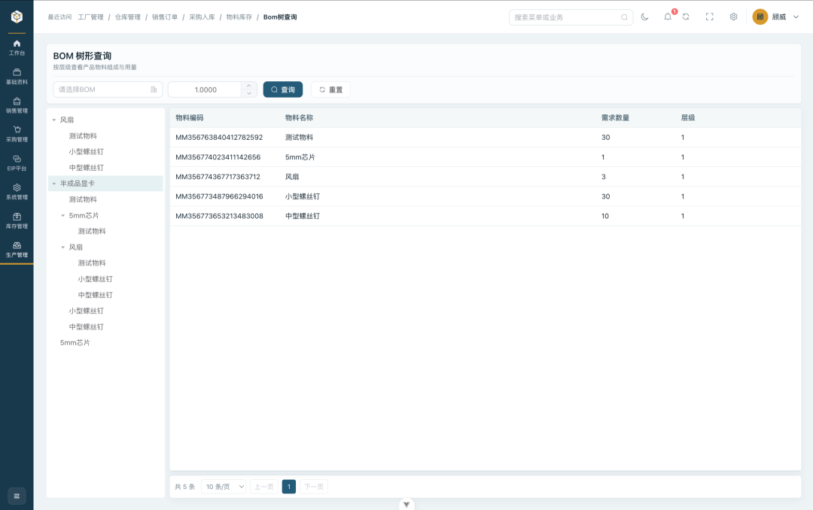
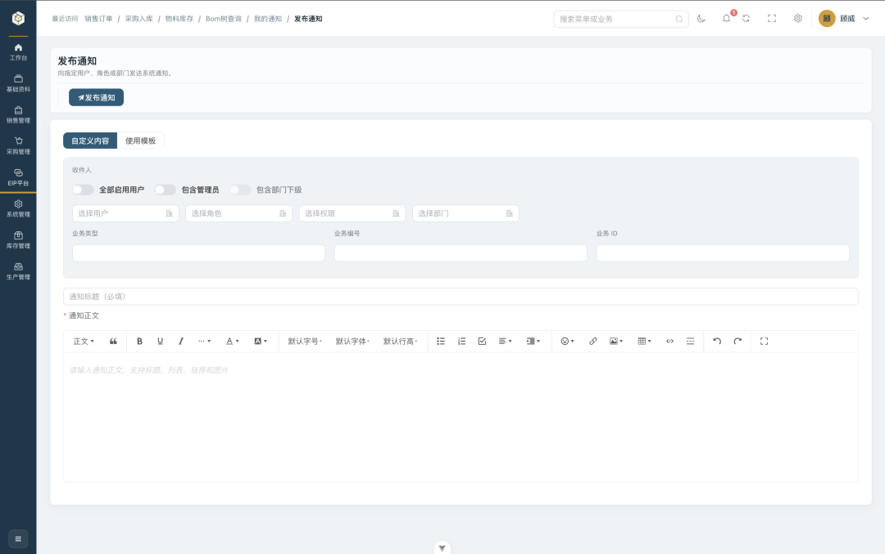

<div align="center">
  <h1>ORIGIN ERP · 原点智造</h1>
  <p><strong>连接订单、物料与现场作业的制造业务系统</strong></p>
  <p>让销售、计划、采购、仓库与产线围绕同一套单据和业务状态协作。</p>
  <p>
    <a href="#产品能做什么">产品能力</a> ·
    <a href="#开始使用">开始使用</a> ·
    <a href="#面向开发者">开发接入</a> ·
    <a href="docs/development.md">开发与部署文档</a>
  </p>
</div>

## 产品定位

ORIGIN ERP 是面向制造企业内部协作的开源业务系统，围绕订单驱动的销售、采购、库存和生产执行展开。它把办公室里的计划与审批、仓库里的出入库、产线上的领料和报工连接起来，让业务进度可以沿单据追踪，让库存变化有据可查。

对于开发团队，ORIGIN ERP 提供可自部署的服务端、Web 管理端和移动作业端。你可以从现有业务流程开始使用，也可以在共享身份、权限、单据和库存规则的基础上扩展企业自己的流程。

### 谁会使用它

| 使用者           | 在产品中完成的工作                                       |
| ---------------- | -------------------------------------------------------- |
| 销售与跟单人员   | 维护客户与销售订单，确认需求，跟进出库和交付状态         |
| 生产计划人员     | 维护 BOM，展开物料需求，生成与下达生产订单，跟踪执行进度 |
| 采购人员         | 处理采购需求与订单，协同到货、入库审核和上架             |
| 仓库人员         | 查询库存，处理采购入库、生产领料、成品入库及销售出库     |
| 产线人员与审核人 | 在移动端登记报工，按权限完成审批，衔接成品入库           |
| 管理员与开发者   | 配置用户、角色和菜单，部署服务，维护数据库并扩展业务能力 |

当前产品聚焦制造业务流转。财务核算、薪资、人力资源和对外商城不在现有交付范围内；采用前应按企业实际流程核对功能和验收结果。

## 产品能做什么

| 业务环节       | 当前能力                                           | 协作结果                           |
| -------------- | -------------------------------------------------- | ---------------------------------- |
| 基础资料       | 客户、供应商、物料、仓库、工厂、车间和产线管理     | 单据引用一致的主数据               |
| 销售与交付     | 销售订单、确认与取消、库存预留、销售出库           | 从客户需求追踪到交付执行           |
| BOM 与生产计划 | 多级 BOM、版本及启停、物料需求展开、生产需求与订单 | 将需求转成生产和备料依据           |
| 采购与到货     | 采购需求、采购订单、入库审核与上架                 | 衔接缺料采购和到货入库             |
| 生产执行       | 订单下达、开工、领料、报工、审批及成品入库         | 现场作业回到订单和库存记录         |
| 库存追踪       | 在库、预留、可用数量及库存流水                     | 查询数量及其变化来源               |
| 待办协同       | 业务通知、未读收件箱、实时提醒与通知模板           | 将下一步工作送达有权限的处理人     |
| 业务助手       | AI 对话、库存及单据查询、待确认的采购审批提案      | 在现有权限范围内查询和辅助处理业务 |

AI 使用已配置的模型服务；业务操作仍由领域服务校验，审批提案需要用户确认。知识库检索（RAG）处于开发草稿阶段。

### 一笔需求如何流转



各环节按单据状态和操作权限推进。报工完成后生成成品入库单，实际库存增加发生在确认入库时；销售预留量与在库量分开记录，可用量按“在库量 − 预留量”计算。

## 三端如何协作

| 仓库                                                                 | 产品职责                           | 主要使用场景                               |
| -------------------------------------------------------------------- | ---------------------------------- | ------------------------------------------ |
| **当前仓库：Service**                                                | 统一业务规则、身份权限、数据与接口 | 服务部署、业务扩展、系统集成和数据库维护   |
| [Web 管理端](https://github.com/weigu2700-cell/ORIGIN-ERP--FrontEnd) | 业务管理与跨岗位协同               | 主数据、订单、计划、审批、查询和运营工作台 |
| [Mobile 作业端](https://github.com/weigu2700-cell/ORIGIN-ERP-Moblie) | 手机和 PDA 现场操作                | 扫码、库存查询、领料、报工与出入库         |

Web 与移动端共享后端账号、权限和业务数据。移动端是员工现场作业入口；小程序构建目标服务于这一场景，对外客户订货商城另行规划。

### 产品界面

<table>
  <tr>
    <td width="50%"></td>
    <td width="50%"></td>
  </tr>
  <tr>
    <td align="center">查看待办与业务进度</td>
    <td align="center">围绕订单组织协作</td>
  </tr>
  <tr>
    <td></td>
    <td></td>
  </tr>
  <tr>
    <td align="center">从产品结构展开物料需求</td>
    <td align="center">把后续工作交给对应处理人</td>
  </tr>
</table>

## 当前交付与部署方式

产品持续迭代，采用前请在自己的业务流程、权限角色和目标设备上完成验收。

| 方式                        | 当前范围                                                                                                       |
| --------------------------- | -------------------------------------------------------------------------------------------------------------- |
| **单组织自部署（single）**  | 默认运行方式，提供现有销售、采购、生产、库存和协同业务；企业自行维护数据、配置及部署环境                       |
| **多组织共用服务（multi）** | 采用一租户一库，已接入组织登录、数据源路由、Flyway、缓存与异步隔离；当前仅开放组织身份链路，正式业务仍返回 503 |
| **移动端交付**              | 提供 H5、App 和小程序构建入口；原生签名、平台配置、相机/PDA 与实际业务联调按目标设备验收                       |

multi 登录后会显示当前组织和“当前组织暂未开放业务”。组织选择界面已接入，两种部署方式的可用范围以服务端为准。

多租户正式开放前还需完成跨组织业务联调、旧单号计数接管、连接预算和备份恢复验收；自动建库、平台运维 UI、连接池热轮换及跨节点 WebSocket 投递尚未交付。详见 [多租户方案](docs/plans/multi-tenancy.md) 和 [当前隔离实现](docs/plans/tenancy-t4-isolation.md)。

## 开始使用

建议先在独立开发环境以 single 模式走通一条订单与库存流程，再按企业需要配置角色、主数据和部署方式。

### 1. 准备环境

服务端需要 JDK 21、MySQL 8.x、Redis，以及初始化脚本使用的 Python 3 和 MySQL 客户端。仓库自带 Maven Wrapper。

```bash
git clone https://github.com/weigu2700-cell/ORIGIN-ERP-BackEnd.git
cd ORIGIN-ERP-BackEnd
```

### 2. 初始化开发数据库

以下入口仅用于独立的空开发库 `smart-erp`，按顺序创建表、导入权限/菜单/开发管理员并校验：

```bash
python3 sql/bootstrap/run.py schema -h127.0.0.1 -uroot -p
python3 sql/bootstrap/run.py seed-dev -h127.0.0.1 -uroot -p
python3 sql/bootstrap/run.py verify -h127.0.0.1 -uroot -p
```

开发账号为 **`admin` / `OriginDev@123`**，仅在显式执行开发 seed 后存在。重跑 seed 保留已有密码；schema 入口不能在已有业务库重跑。生产环境由部署方建立自己的管理员，完整步骤见 [数据库初始化](sql/bootstrap/README.md)。

多租户新库与旧库接管使用 [逐库 Flyway 入口](docs/plans/tenancy-t3-flyway.md)，不要套用上述固定库名脚本；新租户管理员由开通方指定，没有统一默认密码。

### 3. 配置并启动服务

默认配置位于 `src/main/resources/application.yaml`。连接地址、密码和密钥应使用本地环境或外部配置覆盖：

```bash
export SPRING_DATASOURCE_URL='jdbc:mysql://localhost:3306/smart-erp?useUnicode=true&characterEncoding=utf8&serverTimezone=Asia/Shanghai&useSSL=false&allowPublicKeyRetrieval=true'
export SPRING_DATASOURCE_USERNAME='root'
export SPRING_DATASOURCE_PASSWORD='<database-password>'
export SPRING_DATA_REDIS_HOST='127.0.0.1'
export SPRING_DATA_REDIS_PORT='6379'
export JWT_SECRET='<saved-base64-secret>'
export AI_API_KEY='<model-api-key>'
./mvnw spring-boot:run
```

`JWT_SECRET` 可通过 `openssl rand -base64 32` 生成一次并保存，解码后至少 32 字节；环境重启保持同一密钥。当前模型配置读取 `AI_API_KEY`，调用助手时需要真实可用凭据。模型地址及模型名按实际服务配置，见 [开发与部署参考](docs/development.md#配置)。

默认 API 为 <http://localhost:8080>，[Swagger UI](http://localhost:8080/swagger-ui.html) 与 [OpenAPI JSON](http://localhost:8080/v3/api-docs) 可用于联调。Windows 使用 `mvnw.cmd`。single 模式启动时由原 Flyway 轨道执行已有库的增量迁移。

### 4. 接入客户端并核对业务

按 [Web 启动说明](https://github.com/weigu2700-cell/ORIGIN-ERP--FrontEnd#本地运行) 或 [移动端启动说明](https://github.com/weigu2700-cell/ORIGIN-ERP-Moblie#本地运行) 配置相同后端。首次进入后可按以下顺序核对：

1. 登录并确认组织和账号，检查用户、角色与菜单。
2. 建立物料、仓库及需要的客户、供应商、BOM 等主数据。
3. 用独立测试单据走通采购入库、领料、报工或销售出库，核对状态、权限和库存流水。
4. 使用不同岗位账号检查操作范围，在目标手机/PDA 上检查现场流程。

## 面向开发者

### 架构与扩展入口

服务端采用模块化单体，Java 21、Spring Boot、MyBatis-Plus、MySQL 与 Redis 构成业务运行基础；Flyway 管理数据库版本，WebSocket 承担实时通知，Spring AI 接入模型与业务工具。具体依赖以 [pom.xml](pom.xml) 为准。

| 目录                      | 扩展职责                                     |
| ------------------------- | -------------------------------------------- |
| `system`、`tenant`        | 用户权限、组织身份、租户数据库与迁移生命周期 |
| `master`                  | 客户、供应商、物料、仓库和生产组织资料       |
| `sales`、`purchase`       | 销售、采购单据及业务状态                     |
| `production`、`inventory` | BOM、生产执行、库存与流水                    |
| `eip`、`ai`               | 待办通知、业务查询与受确认约束的 AI 动作     |

新增业务建议沿 `controller → service → mapper` 扩展，把状态、权限和事务约束留在服务端；Web 与移动端复用同一规则。外部系统接入使用服务 API，并按 OpenAPI 确认接口契约，不直接写业务表。

### 数据与接口约定

- 登录后使用 `Authorization: Bearer <token>`；组织来自已验证的 JWT，客户端不能指定数据库。
- 普通接口使用 `{ code, msg, data }`，流式助手使用 SSE；`Long` ID 对 JavaScript 客户端按字符串处理。
- 数据库、缓存、通知和 AI 回调需保持相同组织与用户边界；新功能应覆盖异常、重复提交和权限变化。
- 已执行的 Flyway 脚本保持不可变，结构变化新增版本；平台库、租户库与旧 single 库分轨维护。

### 开发检查

```bash
./mvnw test
./mvnw clean package
# 隔离数据库回归，需要 Docker
python3 sql/bootstrap/test_seed.py
python3 sql/platform/test_tenants.py
```

单元测试、数据库集成测试与真实业务验收分别记录。缺少 Docker 或集成环境造成的跳过不能作为隔离验收通过；模型桩测试不替代实际模型联调。

## 文档导航

| 文档                                                 | 内容                                   |
| ---------------------------------------------------- | -------------------------------------- |
| [开发与部署参考](docs/development.md)                | 配置、接口、缓存、通知、AI 与发布细节  |
| [数据库初始化](sql/bootstrap/README.md)              | 单组织 seed、默认账号、执行顺序与验收  |
| [Flyway 与租户维护](docs/plans/tenancy-t3-flyway.md) | 新库开通、旧库接管、逐库升级、失败恢复 |
| [缓存与异步隔离](docs/plans/tenancy-t4-isolation.md) | Redis、通知、WebSocket、AI 的组织边界  |
| [AI 模块](docs/ai-architecture.md)                   | 工具、确认动作、对话记忆和当前范围     |

## 产品演进与参与

近期工作围绕多租户业务验收、现场作业可靠性和部署维护展开。客户订货商城、知识库和表单配置等能力仍需独立设计与验收；阶段方案见 [多租户设计](docs/plans/multi-tenancy.md) 与 [需求讨论记录](docs/plans/open-issues.md)，其中历史阶段记录不等于当前交付清单。

通过 [Issues](https://github.com/weigu2700-cell/ORIGIN-ERP-BackEnd/issues) 提交问题或需求时，请描述使用角色、业务场景、部署模式、预期行为和可复现步骤，并移除账号凭据与企业数据。贡献 PR 请说明业务影响、数据库迁移和验证方式；界面、接口和文档随行为变更同步更新。

本仓库采用 [MIT License](LICENSE)。
