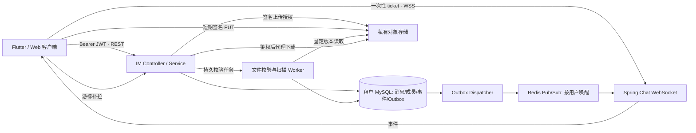
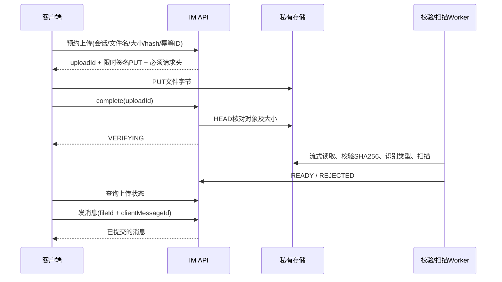

# 多人实时聊天 · 后端设计方案

状态：后端首版已实现，默认关闭。确认范围见 [交付首页](README.md)，实际部署及验证边界见 [部署说明](deployment.md)。

## 1. 范围与架构选择

同组织员工可发起单聊、建立群聊、发送文本/图片/办公文件；支持历史、未读、已读水位、多设备与断线恢复。群主/管理员管理群成员，消息不触发 ERP 审批、出入库或 AI 动作。

| 路径 | 优点 | 成本 | 判断 |
| --- | --- | --- | --- |
| 当前 Spring 服务内新增 IM 模块 | 复用员工身份、租户库与运维；数据自持 | 自己负责投递、容量及文件生命周期 | 本稿推荐，适合首版受限群规模 |
| 第三方托管 IM | 离线推送、超大群等能力较齐全 | 账号映射、费用、外部数据托管、SDK 与服务商绑定 | 若首版就要求大群/通话/强离线到达，重新评估 |

本稿不是自写通用 IM 平台，也不另起 Netty 网关。成熟基础组件处理连接、存储和重试；自有代码只负责项目的会话归属、群规则、消息状态及租户边界。

- REST 是写入确认与恢复来源，WebSocket 不发送业务命令和文件二进制。
- MySQL 提交成功才返回发送成功并形成待投递事件；WS 写入成功不等于用户已阅读。
- Redis Pub/Sub 只做跨节点唤醒；消息、事件和未读不能只存在 Redis。
- 原 `/ws/notification` 协议保持原样；新增 `/ws/chat`，使用与通知分离的CHAT连接索引，不能让旧通知处理器收到聊天信封。

## 2. 当前资产与新增部分

| 当前源码 | 复用方法 | 需要补齐 |
| --- | --- | --- |
| Spring Boot / Java21 / MyBatis-Plus / MySQL / Redis / Flyway | 沿用当前依赖管理和事务方式 | IM 实体、索引、接口、租户迁移与集成测试 |
| `JwtAuthenticationFilter`、`CurrentUser` | REST 从已认证主体读取 tenant/user | `im:access` 等权限 seed；不接收发送者/租户参数 |
| `TenantExecutor` / `TenantScope` / `TenantKeyspace` | 请求、异步、Redis 全链路绑定组织 | Dispatcher 逐租户执行，不能直接在线程池中调用 Mapper |
| `WebSocketSessionManager` | 复用并发会话装饰和过期清理思路 | 独立登记 CHAT 连接，复用 Spring 有界装饰器；成员/权限动态复核 |
| 现有通知握手使用 URL JWT | 不直接照搬到新 IM | 60秒一次性票据、原子消费、Origin 策略、限流 |
| 通用文件服务不存在 | 新增 `AttachmentStorage` 与检查端口 | 私有存储、签名 PUT、校验/扫描、代理下载、清理任务 |

建议目录 `org.smart.erp.im/{controller,service,repository,entity,dto,vo,websocket,attachment,event}`。不把人际消息塞进 `ai_message`、Spring AI ChatMemory 或 `eip.notification`。

## 3. 身份、可见性与群规则

- 全部身份来自 JWT；联系人数据信息最小化，只提供同组织可用员工的ID、显示名、部门、头像。
- `im:access` 是使用门槛，`im:group:create` 允许建群，`im:file:upload` 允许上传。查询、发送、成员管理还必须检查会话成员与业务角色。
- 系统 ADMIN/SUPER_ADMIN 不自动获得非成员会话的读取权。群管理角色是 OWNER/ADMIN/MEMBER，与 ERP 系统角色分开。
- 群2名受邀员工加创建者起建，总数3～200；成员ID去重，全部在同一组织且账号启用。创建事务全成或全败。
- 群主可改群名、增删成员、任免管理员、转让群主、解散；管理员可改群名/加人/移除普通成员；普通成员可发言和退群。
- 群主不能直接退群、被移除或降级；须先转让或解散。转让后原群主为管理员，始终只有一个群主。
- 普通入群不看旧历史；入群 SYSTEM 事件的 seq 是 `visibleFromSeq`。退群/被移除后拒绝在线历史及新下载；重新加入重置可见起点，不恢复旧窗口。
- 解散群进入只读状态，解散时仍在群内的成员可查历史/下载；此前已移除者无权。单聊不适用群成员增删或解散接口。
- 群元数据/成员变更带 `expectedVersion`，行锁后校验；版本不符409，前端刷新后由用户重新决定，不自动覆盖。

## 4. 数据模型与关键约束

表均位于租户库；各表仍记录 `tenant_id` 用于审计与校验，它不替代租户数据源路由。IM ID由MySQL生成，避免现有默认雪花节点号在集群重复；JSON 一律字符串；seq/eventSeq 也用字符串。

| 表 | 主要字段/索引 | 职责 |
| --- | --- | --- |
| `im_conversation` | id,type,name,status,owner_id,creator_id,client_request_id,create_payload_hash,version,last_seq,updated_at；(creator_id,client_request_id)唯一；单聊 direct_user_low/high 唯一键 | 会话状态与序号分配；群的单聊键均为NULL |
| `im_member` | conversation_id,user_id,role,state,visible_from_seq,last_read_seq,unread_count,muted,joined_at,left_at；唯一(conversation_id,user_id) | 当前成员关系与最近一次入群可见窗口 |
| `im_member_change` | id,conversation_id,actor_id,target_id,action,from/to_role,seq,created_at | 记录入退群、角色、群主转移审计，保留旧成员窗口记录 |
| `im_message` | id,conversation_id,seq,sender_id,client_message_id,payload_hash,type,text,file_id,created_at | 唯一(conversation_id,seq)，唯一(sender_id,client_message_id)；历史索引(conversation_id,seq) |
| `im_upload` | id,client_upload_id,conversation_id,uploader_id,key,declared_size/hash,state,expires_at | 唯一(uploader_id,client_upload_id)，跟踪上传预约与校验任务 |
| `im_file` | id,upload_id,conversation_id,uploader_id,message_id,key,object_version_id,name,size,mime,sha256,state | upload_id唯一；成功发送后与一条消息绑定，不接受外部URL或任意key |
| `im_event` | id,type,conversation_id,message_id,payload,created_at | 一次领域事件，正文不为每个用户复制 |
| `im_user_stream` | user_id,next_event_seq | 每用户流的序号分配；按用户ID固定顺序加锁 |
| `im_user_event` | user_id,event_seq,event_id,created_at | 唯一(user_id,event_seq)与(user_id,event_id)，保存7天补偿索引 |
| `im_outbox` | id,event_id,recipient_user_id,state,attempts,next_attempt_at,lease_owner,lease_until | 同事务写入；到期可重领；支持多 Dispatcher |

租户内单聊用两个用户ID的数值排序键唯一，双方并发发起只得到同一会话。`clientMessageId`/`clientUploadId` 在同一组织同一发送者下唯一；复用键且请求内容不同返回409，不能默认为一次成功重试。

### 消息写事务

1. 检查模块权限、账号/组织、当前成员及历史可见性；锁会话行。
2. 先查幂等记录；相同规范化载荷返回原消息，冲突返回409。
3. 对新消息再检查会话可写和文件归属/附件权限；递增 `last_seq` 并插入消息，原子绑定附件；失败全部回滚。已解散只读群中，相同幂等请求仍可返回本人可见的原消息。
4. 对有权接收的活跃成员，按用户ID升序锁用户流水，写 event/user_event/outbox，更新非发送者的未读。
5. 同一事务提交后返回消息；后台 Dispatcher 才开始唤醒/推送。

群成员变更也先锁同一会话行，并生成 SYSTEM 消息/对应事件，确保添加/移除与发消息的先后顺序明确。200人的上限是事务内扇出的设计边界，不承诺无限大群。

## 5. 顺序、幂等与离线恢复

- `message.seq`：会话内提交顺序，SYSTEM 也占号；历史按 seq 返回升序，不按客户端时间或雪花ID排序。
- `eventSeq`：当前用户的持久事件流顺序，涵盖多个会话、已读与成员变更。WS 并行投递可乱序/重复，客户端按 eventId 去重、按 eventSeq 补齐后推进游标。
- 幂等成功期限随消息保留；历史消息不自动删除，不能只给 Redis 幂等键5分钟TTL后允许重复落库。
- Outbox 至少一次处理；WS 本身按尽力到达。失败退避重试，超过阈值进入可观测失败状态，不能静默丢弃；用户始终可从 MySQL 补拉。
- 新节点不用读取其他节点连接表：Redis 广播用户唤醒，各节点只推本机 `(tenant,user,CHAT)` 连接。Redis断连/通知丢失通过前台每30秒 REST 同步水位及重连补拉恢复。
- 更新 `lastReadSeq = max(old, throughSeq)`，不得超过该会话已提交、本人可见的 seq；群已读只提供本人的水位，不承诺逐人已读名单。
- 未读计算排除本人发送及 SYSTEM 消息；不能用 `lastSeq-lastReadSeq` 代替实际未读。推进已读时在受保护事务内重算未读，避免并发新消息被清零。
- 会话快照在一次 MySQL 一致性读事务中取得会话/成员数据和用户流高水位；将最多1000个会话的快照结果缓存至租户 Redis 10分钟。后续分页仍逐项复核当前访问权和本次入群窗口；成员退群后重新加入时，旧快照中早于新visibleFromSeq的摘要/内容不得返回，返回410要求重建快照。Redis丢失只导致快照410重建，不影响持久消息。
- 7天事件过期返回410，客户端重新分页获取会话快照与各会话历史，再从快照的 `syncEventSeq` 继续补拉。快照采用固定 `snapshotToken`，新事件不因翻页而漏掉；token有效10分钟，过期重新开始。
- 移除成员后历史事件返回无内容的 `EVENT.SKIPPED`，仍推进eventSeq；专用 `CONVERSATION.REVOKED` 让所有设备清理缓存/附件入口。既有客户端已读内容和下载文件无法回收。

## 6. 文件传输

首版单文件最多 **50,000,000字节**，一条 IMAGE/FILE 消息绑定一个附件；多选文件逐个发送。建议允许 jpg/jpeg/png/webp/pdf/docx/xlsx/pptx/txt/csv/zip；SVG、脚本、可执行程序、宏文档及无法检查的加密压缩包拒绝。具体允许类型可配置，客户端以配置响应为准。

- S3 兼容 SDK 负责签名/流式对象读写；供应商差异封装在 `AttachmentStorage`，部署时验证签名头、长度校验、CORS及checksum支持。
- 签名 PUT 有效5分钟，服务端生成随机对象key；前端只能向指定key写入。用户离群后未到期PUT可能继续上传私有孤立对象，但不能 complete/发送/下载，24小时清理。
- 上传状态：INITIATED → VERIFYING → READY / REJECTED；未绑定时可取消为CANCELLED；24小时仍未绑定消息转EXPIRED并清理。complete 重复调用返回当前状态，不重复建文件。
- 取消上传只取消未发送附件；已绑定消息返回409。取消与发消息/扫描完成共用状态校验，Worker不能把CANCELLED重新改为READY。未过期签名URL仍可能写入新私有版本，待URL过期和物理清理后才释放字节配额，避免反复预约/取消绕过配额。
- 不能信任客户端 Content-Type、文件后缀、HEAD的自报SHA256；Worker 流式重算 hash，复用 Tika MIME 检测库和 ClamAV 扫描服务，V1拒绝嵌套压缩包，配置展开容量、项数和处理超时限制。检查不可用时保持 VERIFYING，不伪装已通过。
- 对象桶必须启用版本控制：complete固定对象版本，Worker校验该版本，READY文件和所有下载均绑定同一 `object_version_id`。未到期上传URL再次PUT只能产生新版本，不能替换已确认的附件；不支持对象版本的存储不能作为V1部署后端。清理任务按版本判断引用，不删除已绑定消息的版本。
- 上传入站和预约均限制大小/类型/用户配额；存储侧用私有隔离前缀和未完成对象生命周期策略控制恶意超额上传，不能只在下载完成后发现超限。
- 未发送的 READY 文件只有上传者可查状态，不能由成员枚举；发送时校验同会话、上传者本人、READY、未被其他消息占用。
- 下载由 `/im/files/{id}/content` 鉴权后代理流式返回，支持单段 Range；拒绝公开桶和长期下载URL。已移除成员不能发起新下载，正在传输或已缓存的字节不能承诺追回。
- HTTP 响应使用 attachment、UTF-8文件名、nosniff、private/no-store；返回原文件名作为显示文本，不把它拼成服务端路径。V1无公开分享、Office在线预览或按URL抓取远程文件。

## 7. 鉴权、租户与连接生命周期

REST继续使用Bearer JWT。新WS通过 REST换取一次性票据，Redis保存票据摘要，TTL60秒，原子GETDEL消费。票据绑定tenant/user/clientId、原JWT到期时间与CHAT用途；票据或JWT到期、账号/组织不可用、模块权限撤回时断开。

现有 `/ws/** permitAll` 不代表无需鉴权；新握手必须完整校验票据。JWT过滤器对新握手的处理与当前 multi 门禁一起调整，不以新增白名单解除未开放租户业务。Origin为部署白名单；原生客户端缺少Origin允许按票据校验，Web客户端还须匹配Origin。票据query须在网关/应用日志脱敏。

成员鉴权在每次写/查询/下载和投递前复核；成员移除事件及时清理相关连接订阅。账号/权限变化通过失效事件及最长10秒复核收敛；不能把建连时的权限快照当永久授权。

心跳30秒，90秒未收到有效心跳断开；单用户最多5个连接、单客户端重复连接替换旧连接。启用 Spring `ConcurrentWebSocketSessionDecorator` 与有界缓冲；慢消费者关闭1013并通过REST恢复，不无限排队。

客户端退出/切组织须先关闭WS、清空本地数据和未发送附件；后端仍按原Token归属校验，不相信客户端tenantId。原生退后台时系统可能挂起连接，首版不承诺APNs/FCM离线送达。

## 8. 建议限制与验收

建议限额：群200人；文本4000 Unicode字符且UTF-8不超过16KiB；单页100；每用户每秒5次发送、突发10次；每用户同时3个上传预约。建议组织已发送附件配额20GB，可配置；达到配额拒绝新预约而不是删旧聊天文件。这些是建议配置，不是现有线上指标。

| 阶段 | 后端交付 | 通过条件 |
| --- | --- | --- |
| P1 基础和文字聊天 | IM权限、租户迁移、联系人、单聊/建群、文本/历史/幂等 | 同ID跨组织互不可见；双请求不重复建单聊/发消息；成员之外不得读取 |
| P2 实时与同步 | ticket、WS、多设备、用户事件流、Outbox/Redis | 重连/丢帧/乱序/重发最终一致；节点重启不丢已提交消息 |
| P3 群管理 | 加人/移除/角色/转让/退群/解散 | 权限矩阵与可见窗口正确；并发移除/发送及失效版本可复现 |
| P4 文件 | 私有存储、上传检查、消息绑定、代理下载、清理 | 50MB边界、伪造大小/类型/hash、失败重传、移除后下载、未引用对象清理 |
| P5 联调和运维 | OpenAPI、测试夹具、指标、部署配置 | Flutter/Web完成同一套联调与异常恢复验收 |

容量验收建议基线（需实测，不作已达到的承诺）：单节点1000在线连接，20条/秒持续文字发送，最大群200人；在测试环境记录REST确认、WS到达、Outbox积压与数据库锁等待P95。文件并发与带宽单独测量；多节点必须做跨节点会话、Redis断连和租户库故障测试。

现已新增租户V4及single增量迁移，不修改已执行的V1～V3。聊天、附件、Outbox、权限/索引回滚与灰度开关分阶段交付；V1默认关闭，通过测试后按组织开放。

## 9. 关键依据

- [Redis Pub/Sub 官方说明](https://redis.io/docs/latest/develop/pubsub/)：Pub/Sub采用至多一次投递，订阅者断连会丢失通知，因此持久消息与恢复游标保存在MySQL，Redis只负责唤醒。
- [S3 签名上传官方说明](https://docs.aws.amazon.com/AmazonS3/latest/userguide/PresignedUrlUploadObject.html)：签名URL上传相同key会替换原对象，因此已确认附件必须固定对象版本，扫描与下载使用该版本。

接口合同是本项目的设计约束；S3兼容供应商是否完整支持这些行为，仍须在部署集成时验证。
