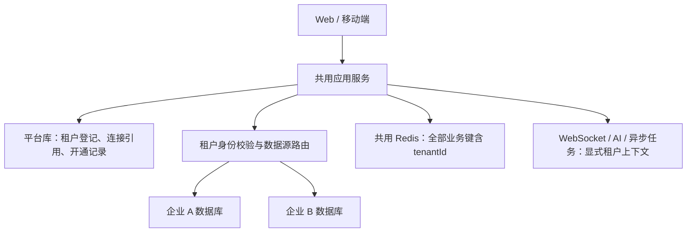

# 多租户实施方案：一租户一库，共用服务

状态：T1/T2 验证原型与 T3 Flyway 逐库生命周期已实现；T4/T5/T6 尚未完成，多租户业务门禁保留。2026-11-02 已确认采用“一租户一库、共用服务”。
依据：当前后端、Web、移动端源码及 [Issue 核查计划](open-issues.md)。实现边界与验证方式见 [T1/T2 最小验证](tenancy-t1-t2.md)、[T3 Flyway 操作说明](tenancy-t3-flyway.md)。

## 1. 首版范围与取舍

首版服务多个独立企业，每个企业的用户、角色、主数据、业务单据、通知及 AI 历史均在自己的数据库。平台库只管理企业、数据库连接引用和开通/运维记录。

| 方式 | 收益 | 成本 | 决定 |
| --- | --- | --- | --- |
| 一租户一库，共用应用 | 业务表无需全面增加 tenant_id；可以单租户备份恢复 | 连接池、逐库升级、缓存及异步隔离必须完善 | 本次采用 |
| 一租户一套部署 | 运行环境也能独立配置和扩容 | 每租户维护部署、版本与监控，成本较高 | 后续独享部署选项 |
| 同库 tenant_id | 数据库与连接数量较少 | 每条查询、关联、唯一约束和自定义 SQL 都必须保证租户过滤 | 首版不混用 |

“一库”指独立 MySQL database/schema。首版可共用 MySQL 实例，但不承诺独立 CPU、IO 或故障域；高负载租户以后可迁至独立实例。首版应用先支持单实例，多实例消息投递单独设验收门槛。

首版不包含统一跨企业账号、一键免登录切企业、跨租户业务查询、套餐计费或跨库事务。每租户账号独立；同名账号可以分别存在。平台运维账号与企业管理员分离，企业 admin 权限始终仅限自己的租户。

## 2. 总体结构

数据路由取自服务端注册信息。客户端只提交企业编码或已签名 Token，不允许提交 JDBC 地址、schema 名、数据库账号或任意数据源名称。

建议使用现有 Spring JDBC 路由能力、Hikari 和 Flyway；首版不增加未经当前工程验证的动态数据源插件，也不拆微服务。Spring 的 AbstractRoutingDataSource 在获取连接时选择目标数据源，适合作为路由扩展点。[Spring API](https://docs.spring.io/spring-framework/docs/current/javadoc-api/org/springframework/jdbc/datasource/lookup/AbstractRoutingDataSource.html)

## 3. 当前代码的具体改动面

| 当前入口 | 现状 | 改造要求 |
| --- | --- | --- |
| `common/config/DataSourceConfig.java` | 单个 Hikari 数据源 | 独立平台数据源、租户路由数据源及连接池注册器 |
| `common/security/JwtUtil.java`、`LoginUser.java`、`CurrentUser.java` | 身份只有用户 ID | 身份增加不可变 tenantId，Token 增加用途/版本 |
| `common/security/JwtAuthenticationFilter.java` | 验签后直接查用户；异常统一清登录态 | 先确定租户再查用户，区分认证失败、租户停用与数据库故障 |
| `system/cache/*`、`production/cache/BOMRedis.java` | 键主要按用户/物料 ID 组织 | 数据键、锁、索引集合和失效操作都增加租户维度 |
| `common/sequence/BusinessNoGenerator.java` | 全局业务序列 | 每租户独立序列；迁移原库时保留已有单号并核对计数 |
| `WebSocketAuthInterceptor`、`WebSocketSessionManager` | 会话只索引 userId | 握手校验租户，连接按 tenantId + userId 分组 |
| 通知事件与监听器 | AFTER_COMMIT 后独立写通知 | 事件冻结 tenantId；监听器进入相同租户后开启新事务 |
| AI Service、工具、ChatMemory、待确认动作 | 有认证恢复，未携带租户 | 认证和租户一起传播，模型记忆、保存、动作执行都检查租户 |
| `sql/smart-erp/*`、`sql/bootstrap/*`、旧迁移 | 固定 `smart-erp`，含手工建表流程 | 新租户使用独立基线和迁移路径；旧迁移保持不可变 |
| Web/移动端登录与状态仓库 | 仅账号密码，缓存缺少企业边界 | 增加企业编码，切换企业时清理完整会话和旧请求 |

还需盘点自定义 SQL、直接 JDBC、导入导出和进程内缓存；业务连接不能通过限定库名访问其他租户。数据库权限作为第二层约束，每个运行账号只访问自己的租户库。

## 4. 平台数据模型与开通流程

以下为完整目标契约。当前已实现租户登记、连接登记和迁移操作记录；完整字段以 Flyway 脚本为准，平台运维人员和综合审计表尚未实现。

| 平台表 | 主要字段与约束 |
| --- | --- |
| `plt_tenant` | id、唯一 code、企业名称、生命周期状态、状态版本、创建/停用时间 |
| `plt_tenant_database` | tenant_id 唯一、服务器连接配置、schema_name、凭据引用 secret_ref、routing_version、实际 schema_version、迁移状态 |
| `plt_operator` | 平台运维人员及角色；与租户 `sys_user` 分开 |
| `plt_tenant_operation` | tenant_id、操作类型、幂等请求号、当前步骤、目标版本、结果与错误摘要 |
| `plt_audit` | 操作人、租户、动作、request_id、时间与结果；不存密码或 Token |

开通状态：`PROVISIONING → ACTIVE`；失败进入 `FAILED`，可按步骤重试；停用进入 `SUSPENDED`。schema 状态单独记录为 READY / UPGRADING / FAILED，避免将迁移失败误认为可正常使用。

开通顺序：登记并锁定请求 → 分配库名与独立账号 → 初始化 schema → 写公共权限/菜单及管理员初始化流程 → 校验连接与版本 → ACTIVE。
只有全部完成才开放登录；失败不能留下可登录的半初始化租户。平台写记录与建库属于不同事务，靠状态机和步骤幂等恢复，不能假设一个本地事务能覆盖建库操作。

运行时账号不授予建库权限。建库/迁移使用独立的受控执行身份；数据库凭据保存在配置密钥系统中，平台库只保留引用。管理员由部署方设置密码，不自动创建通用开发账号。

## 5. 登录、请求和数据源路由

### 登录与 Token

拟定登录参数：`tenantCode + username + password`。Web 和移动端增加“企业编码”，未来域名可以作为辅助输入，但仍由平台登记校验。

1. 从平台库解析企业编码，校验企业和 schema 可用。
2. 在受限的租户作用域内连接目标库，校验该企业的账号密码。
3. 签发业务 Token，包含 `tenantId`、用户 ID、`aud=tenant-api`、签发/过期时间和 Token 格式版本；ID 使用字符串。
4. 平台运维 Token 使用独立用途及认证链，不能凭平台角色直接访问租户业务接口。

拟定提供 `POST /auth/tenant/resolve`，仅返回企业名称与是否允许登录，不公开租户列表、账号、schema 或连接信息。

### 已认证请求

验签和 Token 用途校验 → 读取已签名 tenantId → 校验租户状态与可服务版本 → 打开租户作用域 → 在该库查用户/权限 → 执行业务事务 → finally 恢复/清除上下文。

业务接口以 Token 的 tenantId 为准。额外的请求头或域名若与 Token 冲突，应拒绝，不能据此换库。JWT 无效返回 401；租户停用或身份用途不符返回 403；租户库暂时不可用返回 503，不伪装成密码错误或把用户反复踢回登录页。

### 路由与连接池

- 平台 Mapper、SqlSessionFactory、事务管理器与租户业务的对应组件显式分开；禁止平台 Mapper 隐式使用主业务数据源。
- `TenantDataSourceRegistry` 按 tenantId 与 routing_version 管理连接池，采用按租户互斥创建、容量上限、闲置回收和配置轮换；不在每次请求中重建全局数据源映射。
- 不在同一连接上按请求执行 `USE` / `setCatalog`。一个连接池固定连接一个租户库，业务事务开始后禁止切租户，包括嵌套调用。
- 多租户模式缺少 tenantId、注册信息或连接时立即失败；不设置业务默认库。仅 `setLenientFallback(false)` 仍不能解决空 lookup key 的默认库回退，必须额外做必填校验与无默认库配置。[Spring fallback 语义](https://docs.spring.io/spring-framework/docs/current/javadoc-api/org/springframework/jdbc/datasource/lookup/AbstractRoutingDataSource.html#setLenientFallback(boolean))
- 不启用未经隔离验证的 MyBatis 二级缓存；一级 SqlSession 也不能跨租户复用。
- 预算按“应用副本数 × 每副本活跃租户池数 × 单池连接上限 + 平台/迁移/管理连接”计算。连接数、空闲回收时间和队列上限需压测决定，不假设租户数等于可无限增长的连接池数。

租户状态可使用有界缓存并广播失效。建议初始停用生效目标为 15 秒以内，需通过测试证明；控制数据失效后不能无限使用旧记录。停用后阻止新请求和新动作，关闭关联 WS/流式任务；已提交的业务不撤销，已开始的事务按明确策略完成并审计。

## 6. Redis、WebSocket、AI 与异步边界

| 边界 | 隔离规则 |
| --- | --- |
| Redis 数据/权限/菜单/BOM | 统一 `erp:t:{tenantId}:...` 前缀，不能只改部分缓存类 |
| Redis 锁、计数、集合索引 | 同样包含 tenantId；“清全部权限缓存”仅清当前租户集合 |
| 业务单号 | 每租户单独生成；不同企业允许同号，日志必须同时记录 tenantId |
| WebSocket | 握手同时验证企业/用户，连接键为 `(tenantId,userId)`；每条事件携带并核对企业 |
| 通知事务事件 | 产生时冻结租户，AFTER_COMMIT 处理时先恢复租户再打开 REQUIRES_NEW 事务 |
| AI 查询工具 | 不可变 tenantId、认证快照一同传入 ToolContext；执行前恢复，finally 还原线程原上下文 |
| AI 历史和 JDBC ChatMemory | 存入租户库，模型记忆标识还包含 tenantId；禁止启动时通过“当前路由”自动创建记忆表 |
| AI 待确认动作 | Redis 键、值、锁均带 tenantId，确认时校验租户、用户、有效期和业务版本 |
| 导出、后台任务、未来 RAG | 任务与产物带租户；文件或向量索引命名空间独立；结果下载仍需租户授权 |

建议创建 `TenantScope`，使用 try-with-resources 保存/恢复线程上下文，不使用 InheritableThreadLocal 隐式传给线程池。不可只在 Servlet Filter 设置 ThreadLocal：Reactor 调度后线程可能变化，需要以 Reactor Context 保存快照，并在每个阻塞数据库操作、模型记忆与工具边界恢复租户和认证。[Reactor 上下文传播说明](https://projectreactor.io/docs/core/release/reference/advanced-contextPropagation.html)

首版单实例仍保留多个企业的连接组。启用多应用实例前，需增加 Redis 消息转发或其他消息总线，使任一节点提交的通知能到达持有连接的节点。实时通道不承诺可靠重放，收件箱数据库是依据；重连后补拉未读。避免“本地直接推一次、订阅又推一次”的双重投递，并验证按事件 ID 去重。

## 7. schema 初始化、已有库接管与回滚

现有 SQL 固定库名，不能简单循环执行到各租户。已经应用的版本迁移不可直接修改，避免破坏 checksum 与历史；MySQL DDL 也不能假设失败后自动回滚。[Flyway 多库发布原则](https://documentation.red-gate.com/flyway/deploying-database-changes-using-flyway/rolling-out-updates-from-a-single-schema-to-multiple-production-databases)、[DDL 与独立 schema 历史](https://documentation.red-gate.com/fd/frequently-asked-questions-277579363.html)

T3 已采用明确的新迁移轨道，实际操作见 [Flyway 操作说明](tenancy-t3-flyway.md)：

1. 冻结目标应用 commit 与当前实际 schema，盘点该版本的 DDL、已提交增量与公共 seed，生成不限定库名的 `db/tenant-migration/V1__tenant_baseline.sql`。
2. 租户轨道使用独立历史表 `flyway_tenant_schema_history`。平台使用另一迁移目录与自己的历史，二者不共享一个全局 schema_version。
3. 新租户：在目标数据源执行 V1、公共 seed 和后续 V2+，不写开发账号，也不通过路由默认库初始化。
4. 既有 `smart-erp`：先备份并校验实际结构确实等价 V1，才在新历史表建立 version=1 基线。原 `flyway_schema_history` 留存；存在差异时先修正/明确差异，不能直接 baseline 跳过。
5. 接管后的库只由租户轨道迁移；旧迁移目录保留给旧版本和未接管库，不能让两个迁移器同时管理同一批后续变更。不要全局开启 baseline-on-migrate 以掩盖未知库状态。
6. Spring AI 记忆表也纳入租户基线，关闭框架的启动自动建表。开通流程负责对每个租户初始化。

迁移执行器逐库校验、记录版本、先试点再分批升级。某库失败时只阻止该租户服务，不继续标记成功；保留失败步骤和可恢复说明。schema 与应用需要定义兼容版本范围，先扩展后收缩，不能让老节点访问不兼容新结构。

接管现有企业时，优先直接把原库注册为首个租户，不重写业务 ID 或整体复制数据。上线前演练备份恢复及请求切换。回滚应用仅限已验证兼容的 schema；有新写入后不得简单恢复旧快照，否则会丢业务数据。破坏性清理放到后续独立阶段。

## 8. Web 与移动端改造

- 登录页增加企业编码；单企业模式可隐藏但由服务端显式绑定固定租户。
- 页面持续展示当前企业，错误提示区分企业停用、无权限、网络故障。
- 切企业采用退出再登录：中断请求和 AI 流，关闭 WS，清理用户/权限/菜单/通知/业务列表/当前仓库，再建立新上下文。
- 本地业务缓存或仓库键增加 tenantId。登录辅助企业编码可保存，不能保存或复用旧 Token 到另一个企业。
- 请求增加会话代数或凭据快照校验：旧企业晚到的成功响应、401、WS 消息及 finally 都不能覆盖或清除新企业状态。
- API 业务路径保持原样，避免同时重写全部业务 Controller；新租户身份来自统一认证层。

## 9. 单企业兼容与上线门槛

建议显式配置 `tenancy.mode=single|multi`。
`single` 必须配置固定 tenantId 和连接映射；`multi` 不接受缺失企业的业务身份，也不回退首个租户。
旧的无 tenantId Token 只可在受控单企业迁移窗口兼容，进入 multi 模式后必须拒绝并要求重新登录。最终两个模式都使用统一的业务租户上下文。

上线必须通过两库同 ID 测试，而不是只用两个不同用户：

1. A/B 同时存在 userId=80001、相同物料/订单/会话 ID；查询、写入和删除均不跨库。
2. A Token 搭配 B 请求头、B 资源 ID、B AI 动作 token 都不得访问 B；平台 Token 不能直接执行业务。
3. 相同 ID 不串缓存、锁、序列、菜单失效、通知、模型记忆和待确认动作。
4. SSE 跨线程、工具调用、AFTER_COMMIT、新事务、异常、取消后，线程池复用仍不残留企业上下文。
5. 缺失上下文、停用租户、单库不可用时拒绝或返回对应错误，不切换其他库；另一租户继续可用。
6. 新建、失败重试、旧库接管、滚动迁移失败及备份恢复通过演练，租户实际版本与平台记录一致。
7. Web 与移动端切企业后，旧请求晚到也不恢复旧用户、仓库、未读数或动作弹窗。
8. 验证连接预算；启用多实例时另外验证跨节点通知、配置失效和总连接数。

这些是完整上线标准。T1/T2 与 T3 已验证请求路由和 schema 生命周期；缓存、消息、异步与双端切换等标准仍待实现，不能据此上线完整多租户业务。

## 10. 实施顺序与代码组织

建议新增 `org.smart.erp.tenant`，内部按 registry、context、datasource、provisioning、migration、web、event 分包，避免在业务方法中散布选库逻辑。

| 阶段 | 交付 | 通过条件 |
| --- | --- | --- |
| T1 基础契约 | 平台 schema、租户状态机、不可变 TenantIdentity、双库测试夹具 | 两个租户可独立登记；失败状态可恢复；不修改原业务表 |
| T2 登录与路由 | 登录参数、Token、平台/业务 Mapper 和事务管理器、池注册器、single 模式 | 同 ID 的双库 HTTP 读写隔离；无上下文立即失败 |
| T3 schema 生命周期 | 无限定库名 V1、独立历史、开通 seed、旧库接管和迁移执行器 | 新库和原库各走通一次，失败不激活、历史可追踪 |
| T4 全链路隔离 | Redis/锁/序列、WS、通知、AI、异步与导出上下文 | 所有同 ID 和线程复用测试通过；不得先上线部分隔离 |
| T5 双端联调 | 企业登录、企业展示、切换时取消与清理、单企业兼容 | Web/移动端双企业全流程及晚到响应测试通过 |
| T6 灰度运维 | 版本门禁、连接预算、租户级指标、试点迁移、恢复演练 | 原企业与一个试点企业共存；故障不串库；再分批开放 |

下一步推进 T4：Redis/锁/序列、WebSocket、通知、AI 与异步上下文隔离，再做双端联调。当前逐库迁移仍需维护窗口及人工备份，不含自动建库、排流和恢复。仅完成动态数据源或仅加入 tenantId 不能作为首版上线完成。
